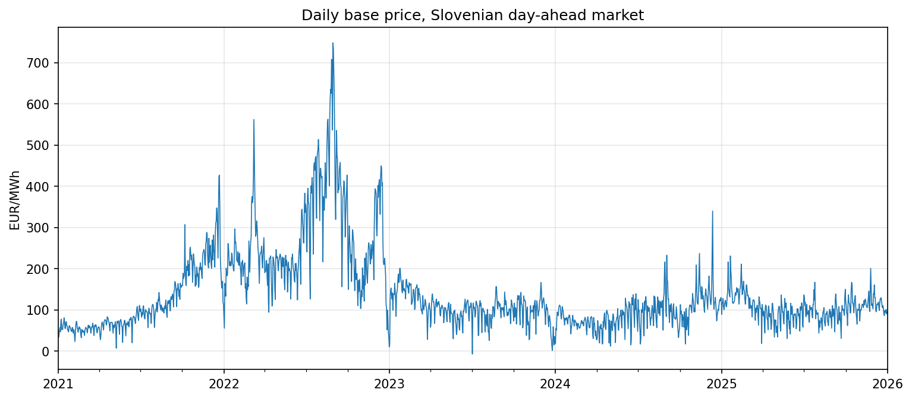
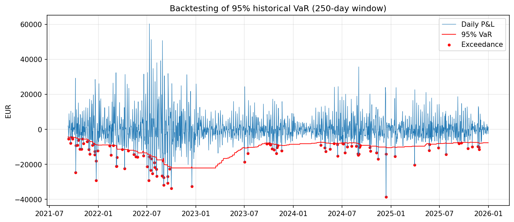
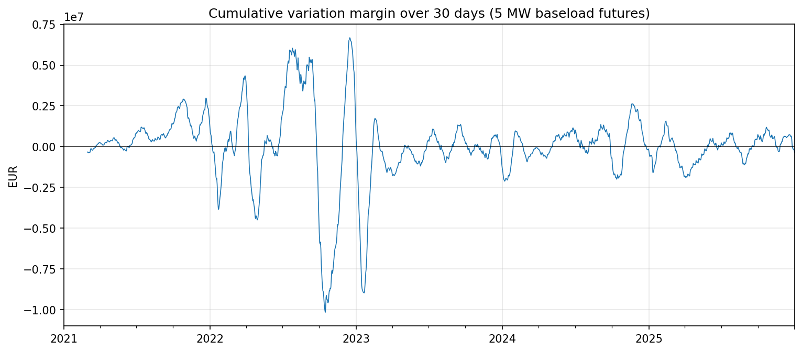

# Energy Trading Risk Analysis: Slovenian Power Market

**Market, liquidity and credit risk of an electricity trading position (2021–2025)**

Selection project prepared by **Peter Velez Vereš** as part of the application for the *Quantitative Developer* position at GEN-I, October 2026.

---

## Povzetek (SI)

Projekt analizira tri ključna tveganja trgovca z električno energijo: tržno, likvidnostno in kreditno. Na podlagi javno dostopnih urnih cen slovenskega dnevnega trga za obdobje 2021–2025 obravnava hipotetično pozicijo nakupa 10 MW električne energije in ocenjuje, koliko lahko podjetje izgubi zaradi gibanja cen, koliko gotovine potrebuje za borzne varščine in kolikšna je izpostavljenost do nasprotne stranke.

Glavne ugotovitve: tveganje se skozi čas močno spreminja (VaR v letu 2022 je bil 2,6-krat višji kot v mirnih letih), predpostavka normalne porazdelitve podcenjuje ekstremne izgube, že majhna borzna pozicija lahko v enem mesecu zahteva več kot 10 milijonov EUR gotovine za varščine, kreditna izpostavljenost pa je največja takrat, ko je razlika med tržno in pogodbeno ceno velika in je v pogodbi še veliko nedobavljene količine.

---

## Executive summary

Energy trading companies are exposed to three closely linked risks. A single price movement simultaneously changes the value of a position (**market risk**), triggers cash margin payments to the exchange (**liquidity risk**), and changes how much a counterparty owes (**credit risk**). The 2022 energy crisis showed how quickly these risks can escalate together.

This project analyses one hypothetical trading position from all three perspectives, using public data from the Slovenian day-ahead market.

## Position analysed

A trader purchases **10 MW baseload** electricity at a fixed price:

| Component | Volume | Contract type | Main risk analysed |
|---|---|---|---|
| Exchange-traded | 5 MW, one year (43,800 MWh) | Futures | Liquidity (margining) |
| Bilateral | 5 MW, delivery 2022 (43,800 MWh) | Forward | Credit (counterparty) |
| Daily position | 10 MW (240 MWh per day) | | Market |

## Key findings

For detailed explanations of the methods and findings, see the [Questions and Answers](QA.md).

### Market risk

**Three distinct market regimes.** Average day-ahead prices rose from 115 EUR/MWh in 2021 to 274 EUR/MWh in 2022, with daily base prices close to 750 EUR/MWh in August 2022, before stabilising around 90–105 EUR/MWh in 2023–2025.

**Negative prices are becoming common.** The number of hours with negative prices grew from 23 in 2021 to 268 in 2025, driven by solar generation. The lowest price, −500 EUR/MWh (then the market's minimum price), occurred on Sunday 2 July 2023 at 14:00.

**Risk is not constant over time.** The 95% daily VaR was about 20,000 EUR in 2022, roughly 2.6 times higher than in calm years (about 7,800 EUR). A single VaR figure for the whole period overstates risk in calm periods and understates it in a crisis.

**Fat tails matter.** Daily price changes are strongly concentrated around zero but include extreme moves. As a result, a normal-distribution VaR overstates risk at 95% and understates it at 99%:

| Confidence | Normal VaR | Historical VaR |
|---|---|---|
| 95% | 13,115 EUR | 10,881 EUR |
| 99% | 18,544 EUR | 21,322 EUR |

**Historical VaR reacts too slowly.** In backtesting with a 250-day window, VaR was exceeded on 6.4% of days overall (expected: 5%), but on 19.3% of days in late 2021, as the market moved into crisis, and on only 3.0% of days in 2023, when the window still contained the 2022 crisis. VaR also jumps abruptly when extreme days leave the window (the "ghost effect").

### Liquidity risk

**Margin requirements dwarf daily VaR.** Because variation margin is settled on the full contract volume (43,800 MWh), cash requirements are far larger than the daily market risk:

| Horizon | Liquidity-at-Risk 95% | Liquidity-at-Risk 99% |
|---|---|---|
| 7 days | 1.09 million EUR | 2.62 million EUR |
| 30 days | 3.78 million EUR | 8.90 million EUR |

**A profitable position can still drain cash.** The largest 30-day cash outflow for the long position was **10.2 million EUR**, in the period ending 16 October 2022, when prices fell sharply after the August peak. A seller of forward electricity would have faced the opposite problem in summer 2022, as many European energy companies did.

### Credit risk

**Exposure depends on both price and remaining volume.** For a forward contract signed on 1 July 2021 at 79.34 EUR/MWh for delivery in 2022, the replacement cost exposure peaked at **8.5 million EUR on 23 December 2021**, not during the August 2022 price peak, because most of the volume had already been delivered by then. The 95% potential future exposure peaked at **12.5 million EUR**.

**Counterparty quality is decisive.** With an average exposure of 3.7 million EUR and an assumed LGD of 60%, the expected loss is about 3,300 EUR for a BBB-rated counterparty and about 66,700 EUR for a B-rated counterparty. This illustrates why weaker counterparties typically require collateral or lower credit limits.

![Credit exposure to
